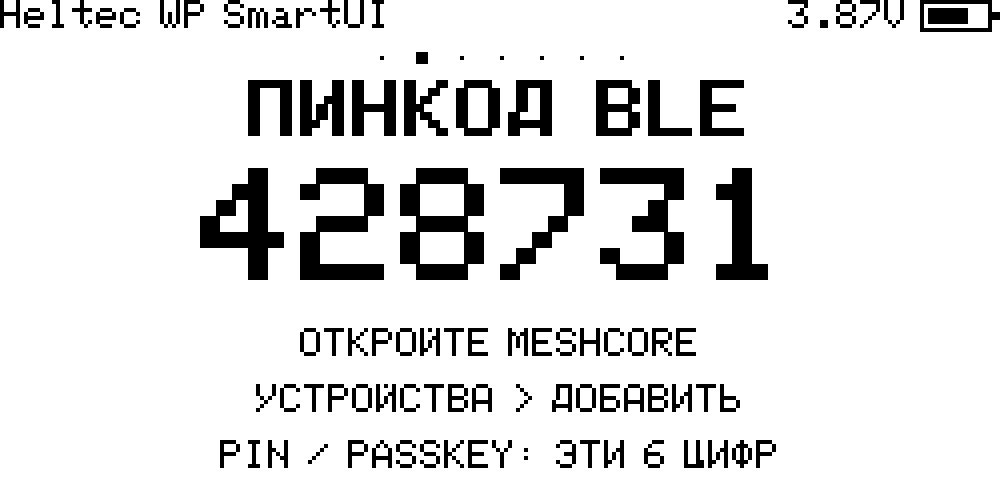

# Прошивка готового UF2 или BIN

Эта ветка описывает единый `SmartUI 0.20` для семи плат. Контрольные суммы: `SHA256SUMS.txt` для UF2 и `SHA256SUMS-ESP32.txt` для всех четырёх ESP32-S3. Один `RELEASE-MANIFEST.json` связывает двенадцать прошивок с общим исходным commit.

[Изменения 0.20](../RELEASE_NOTES_SmartUI_0.20_RU.md); [исторические границы исправлений аудита 0.06](AUDIT_FIXES_0.06_RU.md). Сообщение о чёрном экране/бутлупе V4.3 после app-only update не объявляется исправленным: нужны загрузочный лог и точный файл с SHA256. Не используйте Erase или merged как диагностический эксперимент.

> [!WARNING]
> **Любой ESP32 `merged.bin` — только чистая установка со сбросом данных.**
> V3, V4.3 R2, V4 R8 и Paper merged содержат подготовленную пустую SPIFFS и заменяют
> identity, контакты и настройки даже без отдельной команды Erase Flash.
> Для обновления работающей ноды используйте `update.bin` по `0x10000` без Erase.

> [!WARNING]
> **V3 FS2: merged-файл удаляет сохранённые identity/настройки даже без Erase Flash.**
> Для обновления работающей ноды берите `update.bin` и не включайте очистку.
> После уже выполненного Erase для V3 нужен свежий **merged FS2** по адресу `0x0`.

## Перед началом

1. Уточните точную модель платы по [SUPPORTED_BOARDS_RU.md](SUPPORTED_BOARDS_RU.md).
2. Скачайте UF2/BIN именно из Release или CI-артефакта этого репозитория.
3. Проверьте SHA-256 по [VERIFY_RU.md](VERIFY_RU.md).
4. Подготовьте USB-кабель с передачей данных. Кабель только для зарядки не подойдёт.
5. По возможности безопасно сохраните идентичность ноды. Не публикуйте приватный ключ и не храните его в репозитории.
6. Подключите подходящую антенну до запуска LoRa-передачи.

## Какой файл выбрать

| Плата | UF2 |
|---|---|
| Heltec T096 FEM ON | `T096_UI_0.20.uf2` |
| Heltec T114 с TFT | `T114_UI_0.20.uf2` |
| ProMicro nRF52840 + Heltec RA62 с OLED | `ProMicro_RA62_UI_0.20.uf2` |
| ProMicro / FakeTec V4 с HT-RA62 без дисплея | `ProMicro_FakeTec_RA62_Headless_UI_0.20.uf2` |

Для ближайшего отката скачивайте файл своей платы и манифест из [SmartUI 0.19](https://github.com/YaziAranea/MeshCore/releases/tag/smartui-0.19). Более старые выпуски также сохранены.

| ESP32-S3 цель | Чистая установка / Web Flasher | Обновление приложения |
|---|---|---|
| Heltec V3 OLED | `Heltec_V3_UI_0.20-merged.bin` | `Heltec_V3_UI_0.20-update.bin` |
| Heltec V4.3 OLED FEM ON | `Heltec_V4.3_UI_0.20-merged.bin` | `Heltec_V4.3_UI_0.20-update.bin` |
| Wireless Paper FULL | `Paper_UI_0.20-merged.bin` | `Paper_UI_0.20-update.bin` |
| Heltec V4 R8 OLED FEM ON | `Heltec_V4_R8_UI_0.20-merged.bin` | `Heltec_V4_R8_UI_0.20-update.bin` |

Для FakeTec V4 без экрана используйте отдельный headless UF2. Сверьте стандартную распайку nRF52840 + HT-RA62/TCXO; коэффициент ADC зависит от установленного делителя. Без прежних настроек BLE PIN — `123456`; при обновлении сохраняется прежний код. Неизвестный PIN читается через Helper 2.8 по USB без BLE-сопряжения и без сброса данных; порядок ниже.

**V4.3 R2 и V4 R8 — разные платы.** Проверяйте маркировку R8, OLED, файл и SHA256; одинаковый размер дисплея не делает прошивки взаимозаменяемыми. Для R8 нет подходящего файла в прежних 0.11/0.12. При переходе с иной прошивки сначала проверьте совместимость таблицы разделов; app-only update не меняет bootloader/разметку.

## ESP32-S3: V3 OLED, V4.3 OLED, V4 R8 OLED и Wireless Paper

- `merged.bin` записывается с адреса `0x00000`. Для всех четырёх плат это **только чистая установка со сбросом данных**, не обычное обновление.
- Для обновления уже установленной совместимой прошивки берите `update.bin`; application offset — `0x10000`.
- Не переименовывайте update в merged и не пытайтесь копировать BIN на UF2-диск.
- Команда `esptool` для чистой установки: `esptool.py --chip esp32s3 write_flash 0x00000 <merged.bin>`.
- Команда для update: `esptool.py --chip esp32s3 write_flash 0x10000 <update.bin>`.

Web Flasher должен работать с merged-файлом. Если сервис предлагает выбрать плату, выбирайте свою точную модель V3 OLED, V4.3 OLED R2, V4 R8 OLED или Wireless Paper — они не взаимозаменяемы. Отсутствие R8 в списке флешера не означает, что нужно выбрать R2: используйте загрузку собственного BIN с правильным адресом либо `esptool`. На V3/R8 кнопка навигации PRG/BOOT — GPIO0, не RST; удержание PRG/BOOT во время сброса переводит ESP32-S3 в загрузчик.

### V3 FS2: обновление или восстановление после очистки

**Работающая V3:** сохраните нужные данные, скачайте `update.bin`, проверьте
SHA-256 и запишите приложение по `0x10000` **без Erase Flash**. Этот файл
не содержит раздел SPIFFS и не перезаписывает сохранённые настройки/identity.
Если web flasher поддерживает только merged, не используйте его для обновления
с сохранением данных — выберите способ записи update по указанному адресу.

**V3 уже очищена, после Erase появился `STORAGE ERROR`:**

1. Заново скачайте `Heltec_V3_UI_0.20-merged.bin`
   и актуальный `SHA256SUMS-ESP32.txt` из того же выпуска.
2. Проверьте контрольную сумму. В общем `RELEASE-MANIFEST.json` запись V3
   должна содержать `storage.v3_fs2_recovery: true`; внутри прошивки сохранён маркер `FS2`.
3. Запишите merged FS2 по адресу **`0x00000`**. Повторная очистка не требуется.
4. Перезапустите плату. Если mount не удался, FS2 может подготовить SPIFFS штатной
   библиотекой только после точного совпадения с известным пустым заводским образом.
5. При оставшейся ошибке следуйте экрану восстановления. Форматирование других данных
   требует **двух отдельных подтверждений** кнопкой PRG/BOOT; между ними отпустите кнопку.
   Это удаляет identity, контакты и настройки. Отказ/бездействие ничего не стирают.
6. После успешного запуска настройте ноду заново или безопасно восстановите резервные данные.

**Merged FS2 заменяет SPIFFS пустым хранилищем даже без галочки Erase:**
сохранённые там identity, настройки и другие данные ноды будут потеряны.
Снятая галочка Erase не делает этот файл безопасным обновлением.
Сам update при прошивке не записывает SPIFFS; восстановление после запуска регулируется
описанными выше проверками и подтверждением пользователя.

FS1 не устранила ошибку на пользовательской V3. FS2 не форматирует произвольные
данные автоматически: исключение — только криптографически совпадающий пустой
заводской образ при правильной разметке. Стертый FF-раздел и ошибка чтения под это
исключение не попадают. Если ошибка возникла на ранее работающей ноде без очистки,
сначала сохраните доступные данные; не подтверждайте их удаление наугад.
Успешное испытание FS2 на физической плате пока не заявляется.

### V4.3 / V4 R8 / Wireless Paper: подготовленная чистая установка

Их `merged.bin` содержит canonical formatted-empty SPIFFS точного размера из
реальной таблицы разделов: V4.3 и V4 R8 — `0xC90000 + 0x360000`, Paper —
`0x670000 + 0x180000`. Release validator монтирует образ закреплённым
`mkspiffs 2.230.0`, требует пустой список файлов и побайтовое совпадение с заново
созданным пустым образом. Это host-проверка формата, не заявление об испытании
загрузки на физической плате.

Такой merged заменяет прежнюю SPIFFS пустой и удаляет identity/контакты/настройки
даже без Erase. `update.bin` содержит только приложение, прошивается по `0x10000`
и не касается SPIFFS. При первом отказе mount прошивка разрешает одну native-format
попытку только после полного совпадения единственного SPIFFS-раздела с известным
factory-empty SHA-256 и точной разметкой своей платы. FF, повреждённые или любые
пользовательские байты автоматически не форматируются. Разрушительный
`SPIFFS.begin(true)` не включён: временная ошибка mount не должна стирать данные.
Файлы V3, V4.3 R2, V4 R8 и Paper не взаимозаменяемы.

## Вход в UF2-загрузчик

1. Подключите плату к компьютеру.
2. Быстро дважды нажмите физическую кнопку **Reset**.
3. В системе должен появиться новый съёмный USB-диск загрузчика. Его имя зависит от bootloader и может различаться.

На T114 Reset — отдельная кнопка платы; это не пользовательская кнопка навигации. На ProMicro без установленной кнопки Reset эквивалентом обычно служит быстрое двойное замыкание площадки `RST` на `GND`, но делайте это только при точном понимании распайки своей платы.

Если диск не появился:

- смените USB-кабель и порт;
- повторите двойной Reset немного быстрее;
- закройте программы, удерживающие последовательный порт;
- убедитесь, что на плате есть совместимый UF2-bootloader;
- не стирайте bootloader случайным программатором.

## Копирование прошивки

1. Скопируйте выбранный `.uf2` в корень диска загрузчика.
2. Дождитесь завершения копирования.
3. Диск обычно отключится автоматически, а плата перезапустится.
4. Не выдёргивайте питание в середине записи.

Сообщение операционной системы о внезапном исчезновении диска после успешного копирования часто является нормальной автоматической перезагрузкой загрузчика.

## Первое подключение BLE

### ProMicro / FakeTec Headless без дисплея

**Если прежних настроек нет, PIN — `123456`.** Откройте совместимый
MeshCore-клиент на телефоне, выберите ноду и введите этот код при запросе.
Компьютер для такого первого подключения не нужен.

**При обновлении сохраняется прежний PIN**, в том числе после перехода с OLED
на headless. Сохраняется и выбранный транспорт: прошивка headless сама по себе
не переводит USB-компаньон или Wi-Fi в Bluetooth. Обычная перезагрузка код не меняет.

Если PIN неизвестен:

1. Подключите ноду USB-кабелем с передачей данных к компьютеру. Откройте
   `SmartUI_USB_Helper_2.8.html` в Chrome или Edge; закройте программы,
   занимающие этот USB-порт. HTML — приложение, не файл для прошивки.
2. Для ноды в Bluetooth/Wi-Fi выберите в Helper **«Сервисная USB-консоль (нода BLE/Wi-Fi)»**.
   Для ранее включённого USB-компаньона — **«USB-компаньон (нода USB)»**.
   На новой headless-ноде стандартный режим — Bluetooth.
3. Нажмите **«Выбрать USB-порт»**, дождитесь подключения. Во вкладке
   **«Подключение»** нажмите **«Показать PIN»**.
4. Используйте показанный код на телефоне. Через 30 секунд Helper скрывает
   цифры на экране; сам PIN не изменяется.

**BLE-сопряжение для чтения по USB не требуется.** Кабель не требует переключения
ноды в USB-компаньон. Чтение PIN не меняет код, настройки или выбранный транспорт.
Если выбран USB-компаньон/Wi-Fi, отдельно нажмите **Bluetooth** во вкладке
«Подключение» и подтвердите смену. Текущее соединение может закрыться;
переподключитесь подходящим способом и проверьте режим.

Не стирайте память и не сбрасывайте ноду только ради неизвестного PIN.
Если Helper не подключается, проверьте его выбранный режим, USB-кабель и занятый
порт. Реальная работа Helper с USB на телефоне не заявлена — для этого пути нужен
компьютер. [Подробная инструкция Helper](../tools/usb-helper/README_RU.md).

**«Консоль» выдаёт тайм-аут, а «USB-компаньон» подключается:** нода уже работает
USB-компаньоном и не обслуживает текстовую консоль. Продолжайте настройку и
чтение PIN в работающем режиме. Перепрошивка или сброс не нужны. После явного
переключения ноды на Bluetooth для настройки по USB используйте «Сервисная USB-консоль (нода BLE/Wi-Fi)». Если ни один режим не подключается, проверьте точный файл прошивки,
версию Helper, кабель и выбранный порт.

### Платы с работающим дисплеем

1. На экране часов сделайте один переход вперёд: откроется страница `ПИНКОД BLE` с крупными шестью цифрами.
2. Если показано `Включите BLE`, откройте `Настройки → Система → Подключение`, удержанием откройте выбор режима, выберите `BLE` и подтвердите `СМЕНИТЬ`.
3. Откройте совместимый MeshCore-клиент и найдите companion-ноду рядом.
4. Когда клиент, Android/iOS или операционная система просит `PIN`, `passkey` или «код сопряжения», введите цифры с экрана ноды. Для повторного просмотра вернитесь на часы и сделайте один шаг вперёд.

В семи профилях с дисплеем страница остаётся доступной после подключения, при выбранном USB/Wi-Fi и при выключенном Bluetooth. Сам просмотр не меняет PIN, настройки или выбранный режим. Обычные таймауты экрана и возврата на часы сохраняются; после них страницу можно открыть снова.

При отсутствии сохранённого PIN и успешно инициализированном драйвере дисплея прошивка создаёт случайный код и сохраняет его до очистки/сброса или явной смены пользователем. Запуск SPI-драйвера сам по себе не доказывает физическое наличие панели — поэтому для ноды без экрана выбирайте отдельный headless-профиль. Обычная перезагрузка код не меняет. Если сохранить новый случайный PIN не удалось, используется статический резервный код `123456`; действующий код показывает PIN-страница или USB Helper. Для headless случайный код при чистом запуске не создаётся: действует правило выше. `123456` не является универсальным паролем всех плат.

### Явная смена PIN или возврат с headless на OLED

Команда `set pin N` сохраняет новый код для **следующего запуска**: сначала
дождитесь успешного ответа, затем перезагрузите ноду. До перезагрузки `get pin`
возвращает прежний активный код. `set pin 0` не отключает PIN — она убирает
явно сохранённое значение. На следующем запуске headless использует `123456`,
а экранный профиль с запущенным драйвером дисплея создаёт случайный код.
Это относится и к переходу с чистого headless на OLED, если отдельный PIN раньше
не сохранялся. [Команды и транспорт](CONSOLE_COMMANDS_RU.md#подключение).

### Wireless Paper: PIN и часы на e-paper

Wireless Paper не выводит PIN самопроизвольно: запуск и idle-режим показывают обычные часы. Для просмотра PIN перейдите с часов на один экран вперёд. Страница остаётся в карусели после успешной BLE-связи.

## Что проверить после запуска

- Заставка показывает `MeshCore` и короткое `0.20`. В `Настройки → Дополнительно → О прошивке` доступны SmartUI, Core и идентификатор исходников; USB-команда `info` сообщает также плату и подключения. Встроенные маркеры проверяются валидатором публикации.
- Дисплей соответствует ориентации и размеру платы.
- Один щелчок листает вперёд, двойной — назад, длинный — выбирает.
- BLE подключается и синхронизирует время/контакты.
- Частота, полоса, SF, CR и мощность разрешены для вашего региона.
- На T096/T114 GPS включается как аппаратный; на ProMicro доступен опциональный внешний UART GPS, по умолчанию выключенный.
- На T096 статус FEM/LNA соответствует целевой сборке FEM ON.
- На V4.3 OLED видны аппаратный GPS и FEM/LNA; выдуманного меню зуммера нет.
- На V3 нет пунктов несуществующего GPS/FEM/зуммера; экран и кнопка работают после пробуждения.
- На Wireless Paper радио не пропадает при бездействии, а экран не перерисовывается без изменения framebuffer.
- В `Дополнительно → Калибр. АКБ` отображается реальный коэффициент, который следует сверять мультиметром.
- Защита АКБ показывает порог 3,2 В во включённом состоянии и резервные 2,7 В при выключении. На чистых настройках включена защита 3,2 В; ранее сохранённое выключенное состояние остаётся выключенным.
- В `Система → LED платы` выберите `ВЫКЛ` и проверьте, что штатный LED не вспыхивает при статусе, LoRa TX и уведомлении на том же встроенном GPIO. LoRa TX остаётся рабочим; это отдельное событие, а не признак непрочитанного ЛС.
- Отдельный внешний LED на другом GPIO сохраняет свои настройки. Физический индикатор зарядки может продолжать гореть, если он подключён к питанию и не управляется MCU.
- На ProMicro не должно быть периодического автономного BLE-мигания. Редкий короткий импульс встроенного LED во время операции nRF52 framework с flash/cache остаётся возможным и не означает новое ЛС.

Старые настройки могут сохраниться после обычной прошивки UF2. Поэтому значение на экране или в приложении важнее заводского default из исходников.

## Если экран ProMicro погас

Первый щелчок по пользовательской кнопке D6/GPIO6 должен разбудить OLED и может быть поглощён как wake-событие. После появления часов нажмите ещё раз. Reset для обычного пробуждения не требуется.

Если вы прошили `ProMicro_RA62_SmartUI_v2.0.0-rc1.uf2`, но кнопка электрически подключена не к D6, wake-fix не сможет работать — это аппаратное несовпадение, а не настройка меню.

## Откат

Откат выполняется так же: войдите в UF2-загрузчик и скопируйте ранее сохранённый совместимый UF2. Не используйте бинарник другой платы. Если менялся формат сохранённых настроек, после отката часть новых настроек может быть проигнорирована; идентичность ноды заранее сохраняйте отдельно и безопасно.

Для ESP32-S3 откат выполняется совместимой парой форматов: merged при полной переустановке или update по адресу `0x10000`. Перед сменой ветки сохраните идентичность безопасным способом.

При возврате на stock пересохранение `prefs.json` может удалить неизвестную ему секцию `smart_ui`. Не рассчитывайте на автоматическое восстановление всех настроек после обратной прошивки. Резервный `prefs.json` содержит BLE PIN и другие чувствительные данные в открытом виде: храните приватно и никогда не прикладывайте его к Issue или Release.
