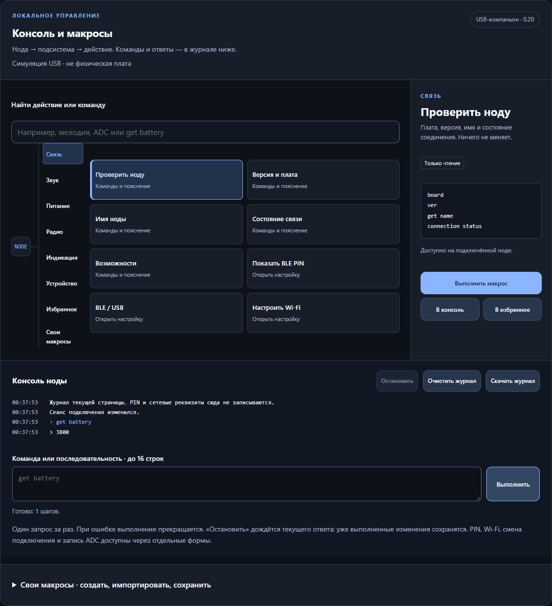
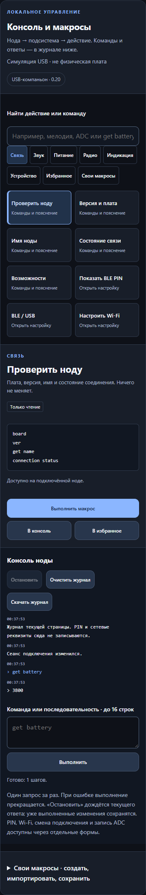

# Helper 2.9 — консоль и макросы

Helper управляет своей нодой через USB-кабель. Вкладка **«Консоль и макросы»**
объединяет дерево действий, краткие пояснения и журнал команд. Работает с обоими
USB-протоколами SmartUI 0.20. Переустанавливать прошивку 0.20 для этого обновления
Helper не нужно.



Снимки показывают дерево команд Helper 2.8, сохранённое в расширенном режиме 2.9.
Они получены с симулятором USB; физические испытания плат ими не подтверждаются.

## Подключение без путаницы

1. Откройте `SmartUI_USB_Helper_2.9.html` в Chrome или Edge на компьютере.
2. Подключите ноду USB-кабелем с передачей данных.
3. Нажмите **«Подключить ноду»**, выберите порт в окне браузера и дождитесь чтения.
4. Откройте **«Расширенное» → «Консоль и макросы»**.

Протокол определяется автоматически без смены режима ноды. При необходимости
ручной выбор протокола доступен в расширенном режиме. Телефон и Bluetooth PIN
для настройки по USB не нужны. [Простое управление с автоприменением](HELPER_SIMPLE_RU.md)
подходит для повседневной настройки; выполнение консольных команд и макросов
по-прежнему запускается отдельной кнопкой.

Для подключения телефона: **«Расширенное» → «Подключение» → «Показать PIN»**. Если нода работает
USB-компаньоном, там же выберите **Bluetooth**. После смены транспорта текущий
сеанс может закрыться. На чистой headless-сборке PIN — `123456`; сохранённый ранее
PIN сохраняется при обновлении. Подробности — в [инструкции прошивки](FLASHING_RU.md).

## Дерево действий

Встроено 40 действий в шести разделах:

| Раздел | Что доступно |
| --- | --- |
| Связь | Версия, имя, состояние соединения, возможности, переход к PIN и BLE/USB/Wi-Fi |
| Звук | Тишина, возврат уведомлений, громкость, мелодия, прослушивание, вибрация, ночной режим |
| Питание | Напряжение АКБ, коэффициент ADC, переход к калибровке, защита аккумулятора |
| Радио | Параметры LoRa, мощность TX, FEM, AGC, переход к радиопресетам |
| Индикация | LED платы, непрочитанные сообщения, каналы уведомлений, переход к выводам |
| Устройство | GPS, тема и тайм-аут экрана, переход к профилю |

Выберите раздел и действие. Справа появятся назначение, параметры и точные
команды. **«В консоль»** только подставляет команды. **«Выполнить макрос»** отправляет
их ноде по очереди. Перед изменением настроек показывается вся последовательность.

Доступность определяется ответами `caps` и `schema`. Имя платы не заменяет проверку.
Недоступные действия остаются видны с пояснением. Поддержка звука не доказывает,
что внешний зуммер физически подключён; GPS аналогично. Переключение FEM TX gain
в публичных профилях 0.20 не поддерживается.

На узком экране разделы и карточки перестраиваются. Мобильная раскладка сама по
себе не означает поддержку Web Serial на конкретном телефоне.



## Ввод команд

Можно отправить одну команду или до **16 строк**. Одна строка — одна команда,
не shell-скрипт. Ограничение команды — **156 байт UTF-8**.

```text
get battery
get adc
get radio
```

- **Enter** — выполнить; **Shift+Enter** — новая строка.
- **↑ / ↓** — история однострочных команд этого сеанса.
- **Tab** — дополнить начало команды из встроенного каталога.
- **Остановить** — дождаться текущего ответа и не отправлять следующие шаги.

Новый ввод принимает общий компактный синтаксис (`get volume`, `set volume 7`).
Для сервисного USB Helper переводит его в `settings get volume`,
`settings set volume 7`. Точные строки сервисного протокола видны в карточке.
Перевод учитывает разные имена параметров и обратный смысл `sound` / `sound_quiet`.

Все строки проверяются **до первого запроса**. Неизвестная последняя строка не
позволит выполнить предыдущие изменения. Ввод ограничен документированным
каталогом: произвольные файловые команды, JavaScript и команды выключения
не выполняются. Полный справочник — [CLI-команды](CONSOLE_COMMANDS_RU.md).

Для прежних прошивок без компактного CLI сохранён отдельный ввод:
**«Файлы и совместимость» → «Совместимая консоль для прежних прошивок»**.
Новые макросы не делают отсутствующие команды доступными старой прошивке.

## Свои макросы

Разверните **«Свои макросы»**. Задайте название, краткое пояснение и команды:

```text
set volume 7
set melody 18
get volume
get melody
```

Сохранение макроса не отправляет команды ноде. Сохранённый макрос появляется в
разделе **«Свои макросы»**; часто используемые действия можно добавить в избранное.
Допускается до **32 собственных макросов**, название до 48 символов, пояснение до 240.

Макросы и избранное сохраняются локально в браузере. Доступ к этому хранилищу
для локальных HTML зависит от браузера и пути файла. Для нового Helper,
другого компьютера или браузера используйте **«Экспорт JSON» / «Импорт JSON»**.
Импорт проверяет весь файл, ничего не выполняет и не заменяет совпадающие
идентификаторы. Максимальный размер файла — 64 КБ. Если браузер запретил локальное
хранилище, Helper сообщит об этом; экспорт сохранит библиотеку отдельно.

## Что происходит при ошибке

Макросы выполняются последовательно; два макроса одновременно не запускаются.
Другие формы записи блокируются на время последовательности. Закрыть USB-сеанс
можно кнопкой отключения; после этого оставшиеся шаги не выполняются.

Успешная запись скалярной настройки проверяется чтением обратно. Подтверждение
`sound preview` означает запуск команды, но не доказывает физический звук.
При общей тишине прослушивание не запускается; Helper её сам не снимает.

Тайм-аут, неверный ответ или разрыв связи останавливают макрос. **Запись могла
успеть выполниться.** Автоматического повтора и отката нет. Переподключитесь,
прочитайте состояние, затем решите, какие команды ещё нужны.

## PIN, сеть и специальные настройки

PIN, сетевые реквизиты, смена транспорта, GPIO, мостовой звук и запись ADC
обслуживаются отдельными формами с соответствующими проверками. Их нельзя
спрятать в пользовательский макрос. Калибровка ADC сохраняется только после
отдельного расчёта и подтверждения; токен не переносится в библиотеку макросов.

Журнал содержит команды и ответы текущей страницы, максимум 300 записей.
История команд ограничена 100 строками и сбрасывается при смене сеанса.
Журнал и история не записываются в постоянное хранилище и не входят в экспорт
макросов. **«Скачать журнал»** сохраняет отдельный текстовый файл по вашему нажатию;
он может содержать имя ноды и радионастройки. PIN и Wi-Fi-реквизиты через новый
командный ввод не принимаются.
