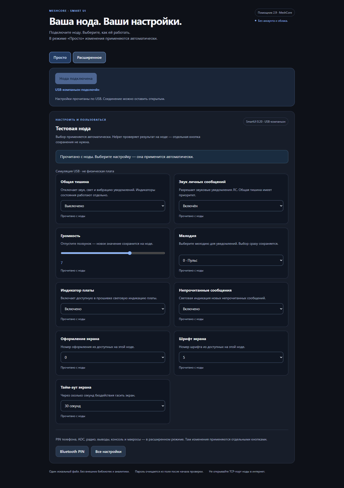
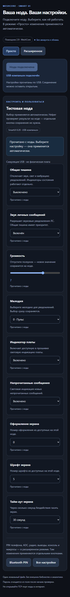

# Helper 2.9 — простое управление

Helper настраивает ноду, подключённую кабелем. Добавленная в прошивку 0.22
[удалённая консоль LoRa](REMOTE_CLI_RU.md) требует совместимого приложения;
Helper 2.9 её не предоставляет.

Откройте `SmartUI_USB_Helper_2.9.html` в Chrome или Edge на компьютере.
Установка и аккаунт не нужны. Автоматическое определение USB-протокола рассчитано
на SmartUI 0.20–0.22. Обновление самого Helper не требует перепрошивки;
исправления хранения из 0.21 требуют установки новой прошивки. Для прежних версий
используйте ручной выбор протокола в расширенном режиме.

По умолчанию открыт режим **«Просто»**. Переключатель **«Расширенное»**
открывает остальные инструменты.

*Симуляция USB, не физическая плата.*

## Подключить → выбрать → готово

1. Подключите ноду USB-кабелем с передачей данных. Закройте флешер и другие
   программы, занимающие этот USB-порт.
2. Нажмите **«Подключить ноду»**. В окне браузера выберите её порт и подтвердите
   доступ. Это разрешение браузера; Helper не может выдать его сам.
3. Дождитесь чтения настроек. Helper определит USB-протокол и покажет доступные
   вашей прошивке обычные настройки. Читать их вручную не нужно.
4. Выберите нужное значение. Обычная настройка отправляется сразу после выбора,
   ползунок — после отпускания. Отдельной кнопки сохранения здесь нет.
5. Дождитесь подтверждения: Helper проверяет ответ ноды и читает результат
   обратно. Только подтверждённое значение считается сохранённым.

Соединение остаётся открытым. После каждого изменения отключать ноду не нужно.
Пока идёт запись и проверка, дождитесь результата; не вынимайте кабель.
Недоступные плате настройки не предлагаются. Наличие команды звука или GPS
не подтверждает наличие физически подключённого зуммера или приёмника.

## Что применяется автоматически

Простое управление содержит обычные настройки звука, тишины, оформления и
индикации, которые объявляет подключённая прошивка: общая тишина, звук ЛС,
громкость, мелодия, вибрация, LED платы и непрочитанных сообщений, тема, шрифт
и тайм-аут подсветки. Оно использует те же
сохранённые параметры, что меню ноды и CLI. Это реальные изменения ноды,
а не предварительный просмотр.

ADC, радио, GPIO, PIN, Wi-Fi и смена способа подключения остаются в
**«Расширенное»**. Их формы сохраняют отдельные кнопки и проверки последствий.
Автоматическое применение простого экрана не меняет поведение этих форм.
[Консоль, дерево команд и пользовательские макросы](HELPER_CONSOLE_RU.md)
также доступны в расширенном режиме.

## Если связь пропала или запись не подтверждена

Не подтверждённая запись **могла успеть выполниться**. Helper не повторяет её
автоматически и не пытается откатить ранее применённое. Нажмите
**«Переподключить ноду»**: Helper закроет прежний сеанс и заново прочитает
тот же разрешённый USB-порт. Запись при этом не повторяется. Дождитесь свежего
чтения, затем решите, нужно ли менять значение ещё раз. Если порт недоступен,
проверьте кабель и снова нажмите «Подключить ноду», чтобы выбрать порт.
Старые неподтверждённые изменения после переподключения не отправляются.

Если порт занят, освободите его в другой программе. Если протокол не определён,
проверьте кабель и прошивку; в расширенном режиме можно выбрать USB-протокол
вручную. Ошибка одной настройки не означает, что нужно стирать память или
перепрошивать ноду.

## Почему больше не нужно выбирать «консоль» или «компаньон»

У SmartUI два USB-протокола: сервисная текстовая консоль при работе ноды в
Bluetooth/Wi-Fi и бинарный USB-компаньон при режиме USB. Кнопка подключения
определяет нужный протокол SmartUI 0.20–0.22 чтением. Она не переключает режим самой ноды и не
меняет настройки. В каждый момент у порта один читатель.

Если используется ручной выбор: для ноды в Bluetooth/Wi-Fi подходит
**«Сервисная USB-консоль (нода BLE/Wi-Fi)»**, для USB-компаньона —
**«USB-компаньон (нода USB)»**. В том числе на FakeTec V4.

## Нода без дисплея и Bluetooth PIN

USB-настройка не требует экрана, телефона или предварительного BLE-сопряжения.
Для PIN откройте **«Расширенное» → «Подключение» → «Показать PIN»**.
Код читается только по нажатию, скрывается через 30 секунд и не сохраняется
в журнале или библиотеке макросов. Просмотр не меняет PIN и режим ноды.

На чистом ProMicro/FakeTec Headless PIN — `123456`; обновление сохраняет
прежний PIN. Для перехода ноды из USB в Bluetooth отдельно выберите Bluetooth
в расширенной вкладке подключения и подтвердите смену. Сеанс может закрыться;
после повторного подключения проверьте фактический режим.
[Подробно о подключении и платах](FLASHING_RU.md#первое-подключение-ble).

*Симуляция USB, не физическая плата.*

## Где работает

Нужен компьютер с Chrome или Edge и Web Serial. Компактная раскладка не означает
поддержку USB в браузере каждого телефона. Helper работает локально, без облака;
настройки на ноду отправляются только по разрешённому вами USB-порту.
Автоприменение и оба протокола проверяются автоматическими тестами с симуляцией
USB. Эти тесты не заменяют испытания конкретной физической платы и проводки.
