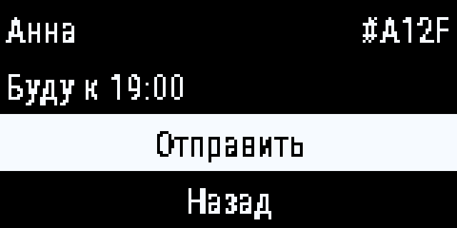
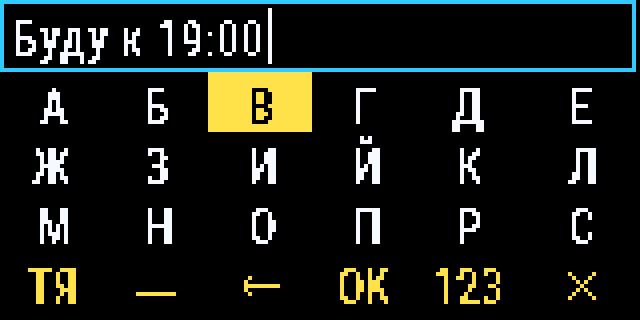
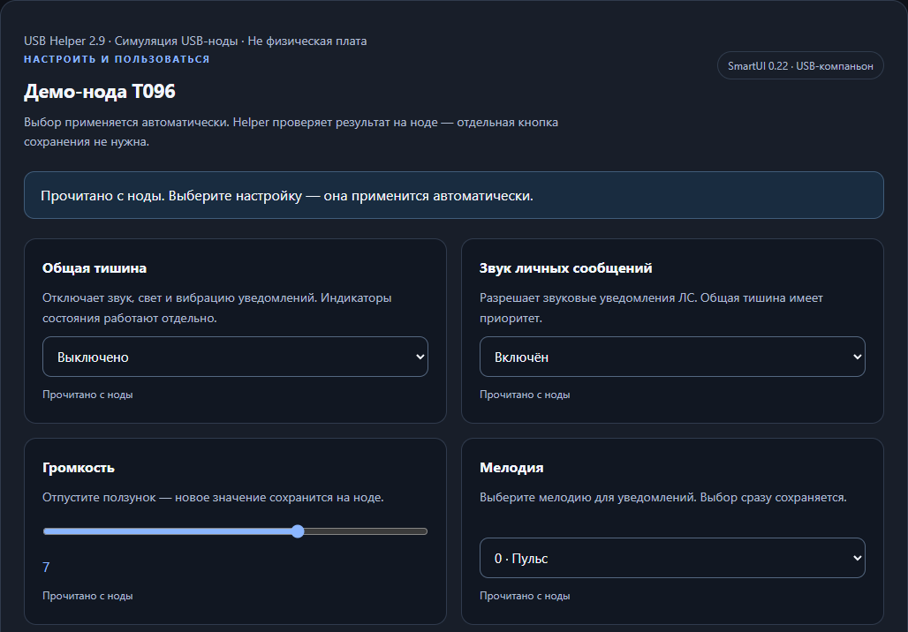

# Как получены кадры для README

Кадры подготовлены для SmartUI 0.22 и USB Helper 2.9. Это демонстрация
интерфейсов с заданными данными, не фотографии устройств и не испытание связи.
Исходное состояние репозитория: `1eccc0e31da8937e0c311ae903947afd0841a489`;
код прошивки в нём совпадает с опубликованным выпуском `3016a1f9`.

## Экран ноды





Демонстрационные данные: контакт «Анна», короткий ID `#A12F`, сообщение
«Буду к 19:00». Первый кадр показывает подтверждение отправки выбранному
контакту, а не чтение входящего сообщения.

Генератор [render_readme_ui.py](../tools/render_readme_ui.py) извлекает из
текущего `UITask.cpp` функции `renderQuickKeyboard`, `renderQuickTargetPicker`
и связанные функции рисования, затем исполняет их в host C++-окружении.
Display-адаптер записывает операции; растеризатор использует встроенные
Roboto compact glyphs и палитру ST7735 «Графит» из исходников драйвера.

Физическая геометрия T096 — 160×80. PNG увеличены до 640×320 методом
nearest-neighbor, без сглаживания пиксельных шрифтов. Проверяются наличие
полного текста и границы отрисовки; повторная генерация даёт те же PNG.
Радио, физические кнопки, яркость панели и полная прошивка не исполняются.
Для других дисплеев геометрия и внешний вид могут отличаться.

Воспроизведение из корня репозитория требует Python 3 с Pillow и `g++`.
На Windows генератор использует установленный `g++` либо `g++` в WSL:

```text
python -B tools/render_readme_ui.py
```

PNG сохраняются в `docs/assets/showcase/`. Параметр `--out` меняет каталог
изображений, `--evidence` — каталог операций рисования, native PNG и отчёта
с хешами исходников. Без `--evidence` используется временный каталог.

## USB Helper



[capture_readme_helper.js](../tools/capture_readme_helper.js) собирает
настоящий автономный HTML Helper 2.9 и открывает его в Chromium через
Playwright. USB заменён тестовым потоком протокола; фикстура сообщает
SmartUI 0.22 и имя «Демо-нода T096».

Широкий снимок — видимый фрагмент панели с четырьмя настоящими настройками:
тишина, звук личных сообщений, громкость и мелодия. На узком экране README
показывает [отдельный мобильный кадр](assets/showcase/readme-helper-mobile.png)
с первыми двумя настройками, чтобы текст оставался читаемым. Единственное добавление
в DOM — поясняющая строка «Симуляция USB-ноды · Не физическая плата».
Элементы приложения и ответы об успешной записи не дорисовываются.

При получении кадра проверяются версия Helper, версия имитируемой ноды,
отсутствие ошибок браузера, внешних запросов и команд записи настроек.
Физическое устройство не подключается. Раскладка дополнительно проверяется
при ширине 390 px; это не подтверждение USB-подключения с телефона.

Требуются Node.js, доступный модуль Playwright, Chromium и Python 3:

```text
node tools/capture_readme_helper.js
```

Необязательный первый аргумент задаёт путь широкого PNG; мобильный сохраняется
рядом с суффиксом `-mobile`. При необходимости используйте
`CHROME_PATH` для выбора Chromium/Chrome/Edge, `PYTHON` для Python и стандартный
`NODE_PATH` для установленного модуля Playwright. Скрипт не устанавливает
зависимости и не изменяет исходники Helper.

Файлы опубликованного релиза для подготовки этих кадров не заменялись.
[Вернуться к README](../README.md).
